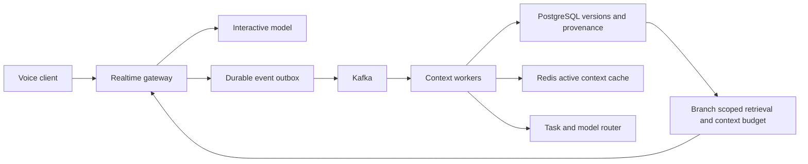

# Voice Context Engine

A runnable local foundation for preserving decisions, topic branches and context
across conversations. SQLite stores event history, versioned memory and leased
background tasks. A JSON-lines gateway accepts finalized transcript text.

**Status:** five core blocks implemented and tested. No audio streaming,
Kafka/PostgreSQL/Redis adapters, embeddings, web UI or deployed server yet.
Default extraction uses explicit `remember key: value` syntax, not an LLM.
An optional Ollama adapter is implemented and mock-tested; no live model
or natural-language quality benchmark has run.

## Quick start

Requires Python 3.11+; runtime has no third-party dependencies.

```sh
PYTHONPATH=src python3 -m unittest discover -s tests -v
PYTHONPATH=src python3 -m voice_context
PYTHONPATH=src python3 experiments/end_to_end.py
```

## Full local conversation flow

```sh
PYTHONPATH=src python3 -m voice_context.gateway --db context.db <<'JSONL'
{"action":"submit","transcript_id":"turn-1","branch":"main","session":"session-1","text":"remember database: PostgreSQL"}
{"action":"work"}
{"action":"status","task_id":"transcript:turn-1"}
{"action":"approve","task_id":"transcript:turn-1","keys":["database"]}
{"action":"fork","branch":"alternative","parent":"main"}
{"action":"context","branch":"alternative","query":"database","budget":512}
JSONL
```

Run a second process with the same `--db` to resume. `submit` persists the task
and transcript without running extraction; `work` performs one task. Partial
transcripts (`final:false`) are ignored. Extraction results are candidates, and
`approve` records the caller's selected keys with original evidence. The gateway
is a local command protocol, not a microphone, HTTP service or autonomous daemon.
Use one reference worker; tasks have no dependency graph or per-branch parallel
ordering guarantee. Authentication/tenant isolation is not implemented.

## Five completed blocks

| Block | Implemented behavior |
|---|---|
| 1. Memory and merge | Version history, direct-child three-way merge, explicit conflict choices, provenance and merge checkpoints |
| 2. Retrieval and context | Weighted lexical matching, Chinese character/bigram matching, exact-key boost, whole-record context budget including JSON/source overhead |
| 3. Task orchestration | Durable queue, leases, stale-worker rejection, delayed retry, attempt limits, cancellation and dead-letter state |
| 4. Candidate extraction | Provider interface, policy routing, explicit fallback, input/output limits, verbatim evidence validation and optional Ollama calls |
| 5. Transcript pipeline | Final transcript intake, durable extraction, explicit confirmation, cross-session recovery, command gateway and reproducible experiment |

Each block was committed and pushed independently. See [progress](docs/progress.md),
[models](docs/models.md) and [end-to-end results](docs/end-to-end.md).

## Correctness and boundaries

- Event/task IDs are idempotency keys; conflicting reuse is rejected.
- Memory versions are append-only. Forks copy materialized history; drain pending
  events first when they should be included. Future parent edits stay isolated.
- `merge(source, target, resolutions)` only supports direct children with a
  recorded baseline. Unresolved conflicts apply no writes. Explicit resolutions
  map conflicting keys to `source` or `target`. Deletion is not modeled.
- Context packing defaults to **UTF-8 byte cost**, not model tokens; inject a
  tokenizer counter for the target model and reserve prompt/output space yourself.
  The older `compact` method remains a word-budget compatibility API.
- Exact source quotes do not prove factual truth, relevance or user intent.
  Caller confirmation separates candidates from durable memory writes.
- SQLite leases protect queue acknowledgements, not external side effects.
  Long tasks may outlive leases; failed calls retry later. There is no heartbeat,
  hard call cancellation, distributed exactly-once claim or production SLA.

## Optional hierarchical model routing

The new [routing module](docs/routing.md) adds ordered model tiers, pre-call
selection, quality-gated escalation, per-request budgets and durable route audits.
Enable it with `python3 -m voice_context.gateway --db context.db --cascade`
under `PYTHONPATH=src`. Default behavior remains unchanged. The controlled
routing comparison uses scripted providers; no real model savings are claimed.

## Experiments

```sh
PYTHONPATH=src python3 experiments/run.py --output /tmp/structured-results.json
PYTHONPATH=src python3 experiments/end_to_end.py
```

The first is the original structured-event fixture; committed `results.json`
records the initial version's run. The second exercises the current full offline
pipeline. Neither measures real speech recognition or LLM reasoning quality.
No résumé performance claims are assumed to be reproduced.

## Intended service architecture



This remains the target service architecture. The current backend uses SQLite
and finalized text input. See [architecture](docs/architecture.md) for future
adapter contracts, production acceptance gates and known limitations.
