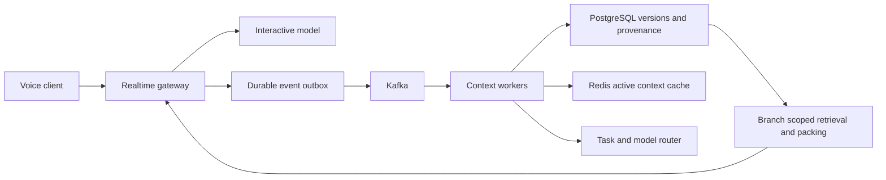

# Voice Context Engine

A runnable foundation for a voice-first workspace that preserves thoughts,
decisions and topic branches across sessions.

**Status: local reference prototype.** The implemented backend is SQLite and the
input is structured text. Audio streaming, LLM extraction, embeddings, Kafka,
PostgreSQL and Redis adapters are not implemented. No external model credentials
or paid services are required for the included demo and experiments.

## Run locally

Requires Python 3.11+; uses only the standard library at runtime.

```sh
PYTHONPATH=src python3 -m voice_context
PYTHONPATH=src python3 -m unittest discover -s tests -v
PYTHONPATH=src python3 experiments/run.py --output experiments/results.json
```

The demo creates a parent decision, forks an alternative, updates its decision,
and recalls both independently. To keep state across processes, construct
`Engine("context.db")` instead of the in-memory default.

## Implemented foundation

- Durable event ingestion separated from background materialization (`drain`).
- Idempotent event IDs, conflicting-retry rejection, transactional processing.
- Topics represented by memory keys; sessions recorded on source events.
- Snapshot branches: parent updates after a fork do not change the child.
- Append-only memory versions with source-event provenance.
- Latest-version keyword retrieval scoped to a branch.
- Whole-record context packing within a word budget.
- Pure model-routing policy for interactive, extraction and reconciliation tasks.
- Local tests, reproducible synthetic experiment and GitHub Actions workflow.

Fork after draining the parent's accepted events if those events must be included
in the snapshot. A fork copies materialized memory, not pending events. A memory
key is a caller-supplied stable identifier; natural-language extraction is future
work. The caller must authorize branch access; there is no authentication layer.

## Intended architecture



This is the target architecture, not a diagram of deployed components. The local
prototype collapses the durable outbox and memory store into SQLite; worker
execution is explicit. See [architecture](docs/architecture.md) and
[experiment report](docs/experiments.md).

## Repository layout

- `src/voice_context/engine.py`: persistence, retrieval, compaction and routing.
- `src/voice_context/__main__.py`: minimal end-to-end demo.
- `tests/`: persistence and branch correctness checks.
- `experiments/`: seeded synthetic benchmark plus captured raw results.
- `docs/`: architecture contracts, limitations and next experiments.

No résumé performance claims are assumed to be reproduced by this repository.
