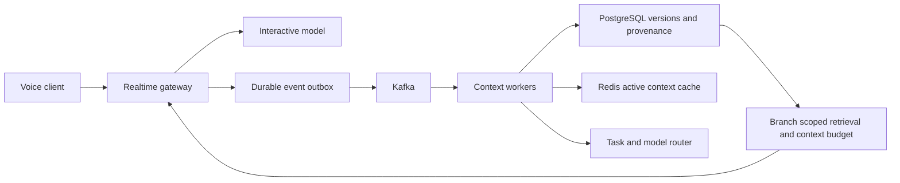

# Voice Context Engine

A runnable local foundation for preserving decisions, topic branches and context
across conversations. SQLite or PostgreSQL stores event history, versioned memory and leased
background tasks. A JSON-lines gateway accepts finalized transcript text.

**Status:** runnable local reference with versioned SQLite memory, branch-aware
final transcript context, a recoverable outbox, durable session epochs, staged
provider interfaces and an opt-in C++ audio/text queue core. The scripted demo
uses synthetic byte payloads, while the opt-in local voice server supports browser
recording and real synthesized speech. No semantic embeddings or deployed service yet. Optional PostgreSQL, Kafka relay/worker
and revision-fenced Redis context cache now run against real local services.
Opt-in OpenAI streaming text and structured extraction are available; eight synthetic
live-model scenarios have been exercised. See [model setup and limits](docs/live-model.md).
A [continuous voice mode](docs/continuous-voice.md) now adds client VAD, authenticated live STT,
automatic playback barge-in and bounded overlapping provider calls. The
[local voice page](docs/local-voice.md) also supports completed-recording STT,
streaming LLM, C++ segmentation/queues and real PCM TTS with browser playback ACK.
Physical microphone/speaker latency and billed-cost savings remain unmeasured.

## Two local views

The [product preview](docs/product-views.md) at `/product` offers a voice-first workspace
with named thought branches and a focused conversation view. The original functional
lab remains at `/` and `/lab`; both use the same local service and persisted state.

The [Documents workspace](docs/voice-documents.md) saves confirmed speech as voice notes,
turns acknowledged replies into editable drafts, and supports version history, source
snapshots, collections, archive/trash, text import and Markdown export.

## Quick start

Requires Python 3.11+; SQLite reference mode has no third-party dependencies.
For the real service stack, see [infrastructure setup and failure semantics](docs/infrastructure.md).

```sh
PYTHONPATH=src python3 -m unittest discover -s tests -v
PYTHONPATH=src python3 -m voice_context
PYTHONPATH=src python3 experiments/end_to_end.py
```

## Full local conversation flow

```sh
PYTHONPATH=src python3 -m voice_context.gateway --db context.db <<'JSONL'
{"action":"submit","transcript_id":"turn-1","branch":"main","session":"session-1","text":"remember database: PostgreSQL"}
{"action":"work"}
{"action":"status","task_id":"transcript:turn-1"}
{"action":"approve","task_id":"transcript:turn-1","keys":["database"]}
{"action":"fork","branch":"alternative","parent":"main"}
{"action":"context","branch":"alternative","query":"database","budget":512}
JSONL
```

Run a second process with the same `--db` to resume. `submit` persists the task
and transcript without running extraction; `work` performs one task. Partial
transcripts (`final:false`) are ignored. Extraction results are candidates, and
`approve` records the caller's selected keys with original evidence. The gateway
is a local command protocol, not a microphone, HTTP service or autonomous daemon.
Use one reference worker; tasks have no dependency graph or per-branch parallel
ordering guarantee. Authentication/tenant isolation is not implemented.

## Five completed blocks

| Block | Implemented behavior |
|---|---|
| 1. Memory and merge | Version history, direct-child three-way merge, explicit conflict choices, provenance and merge checkpoints |
| 2. Retrieval and context | Weighted lexical matching, Chinese character/bigram matching, exact-key boost, whole-record context budget including JSON/source overhead |
| 3. Task orchestration | Durable queue, leases, stale-worker rejection, delayed retry, attempt limits, cancellation and dead-letter state |
| 4. Candidate extraction | Provider interface, policy routing, explicit fallback, input/output limits, verbatim evidence validation and optional Ollama calls |
| 5. Transcript pipeline | Final transcript intake, durable extraction, explicit confirmation, cross-session recovery, command gateway and reproducible experiment |

Each block was committed and pushed independently. See [progress](docs/progress.md),
[models](docs/models.md) and [end-to-end results](docs/end-to-end.md).

## Correctness and boundaries

- Event/task IDs are idempotency keys; conflicting reuse is rejected.
- Memory versions are append-only. Forks copy materialized history; drain pending
  events first when they should be included. Future parent edits stay isolated.
- `merge(source, target, resolutions)` only supports direct children with a
  recorded baseline. Unresolved conflicts apply no writes. Explicit resolutions
  map conflicting keys to `source` or `target`. Deletion is not modeled.
- Context packing defaults to **UTF-8 byte cost**, not model tokens; inject a
  tokenizer counter for the target model and reserve prompt/output space yourself.
  The older `compact` method remains a word-budget compatibility API.
- Exact source quotes do not prove factual truth, relevance or user intent.
  Caller confirmation separates candidates from durable memory writes.
- SQLite leases protect queue acknowledgements, not external side effects.
  Long tasks may outlive leases; failed calls retry later. There is no heartbeat,
  hard call cancellation, distributed exactly-once claim or production SLA.

## Optional hierarchical model routing

The new [routing module](docs/routing.md) adds ordered model tiers, pre-call
selection, quality-gated escalation, per-request budgets and durable route audits.
Enable it with `python3 -m voice_context.gateway --db context.db --cascade`
under `PYTHONPATH=src`. Default behavior remains unchanged. The controlled
routing comparison uses scripted providers; no real model savings are claimed.

## Experiments

```sh
PYTHONPATH=src python3 experiments/run.py --output /tmp/structured-results.json
PYTHONPATH=src python3 experiments/end_to_end.py
```

The first is the original structured-event fixture; committed `results.json`
records the initial version's run. The second exercises the current full offline
pipeline. Neither measures real speech recognition or LLM reasoning quality.
No résumé performance claims are assumed to be reproduced.

## Intended service architecture



This remains the target service architecture. The current backend uses SQLite
and finalized text input. See [architecture](docs/architecture.md) for future
adapter contracts, production acceptance gates and known limitations.


## C++ runtime and staged conversation slice

Read the [full product requirements and implementation boundaries](docs/product/voice-workspace.md)
and [experiment report](docs/runtime-iteration.md).

```sh
python3 scripts/build_runtime.py
export VOICE_RUNTIME_LIBRARY="$PWD/build/libvoice_runtime.so"
PYTHONPATH=src python3 -m unittest discover -s tests -v
PYTHONPATH=src python3 experiments/voice_demo.py
PYTHONPATH=src python3 experiments/realtime.py --output /tmp/realtime.json
PYTHONPATH=src python3 experiments/runtime_benchmark.py --output /tmp/runtime.json
```

A C++17 compiler is required. The library is built explicitly; Python imports do
not compile native code. `Conversation` connects injectable STT/text/TTS ports,
uses persisted reply snapshots and generation fencing, waits for bounded playback
capacity and records stage admissions/durations/provider identity. The included
demo is fully scripted and does not make model calls or generate audio waveforms.

Additional JSONL actions: `session_open`, `session_submit`, `session_interrupt`,
`session_switch`, `reply_begin`, `reply_check`, `reply_seal`, `stage_reserve`,
`stage_finish`, `session_delivery`, `playback_ack`, `recent`, `history`, `correct`
and `revoke`. `context` now includes recent final transcripts before extraction;
its default budget is UTF-8 bytes, with an optional caller tokenizer counter via
Python. Manual `correct` requires `expected_version` and retains prior history.
Stale or revoked extraction candidates cannot overwrite changed confirmed memory.

Queue capacities and software-render cancellation do not establish real audio
latency. Live SDKs, asynchronous network/device adapters and distributed backends
remain separate implementation milestones.

Product session maps: [workflow, persistence, and demonstration scope](docs/product-session-maps.md).
